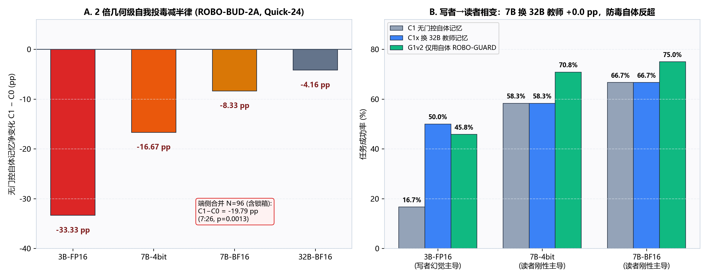
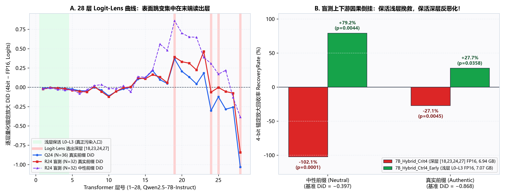
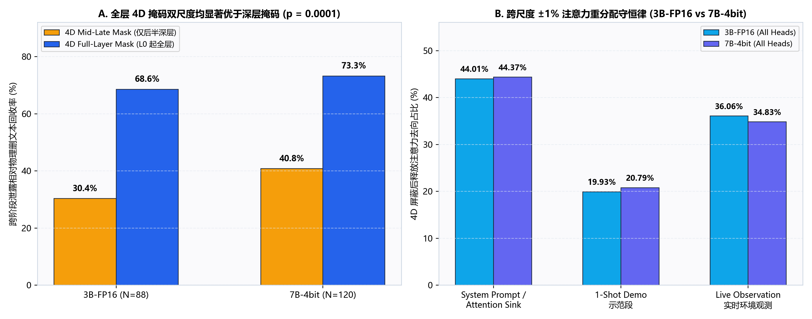
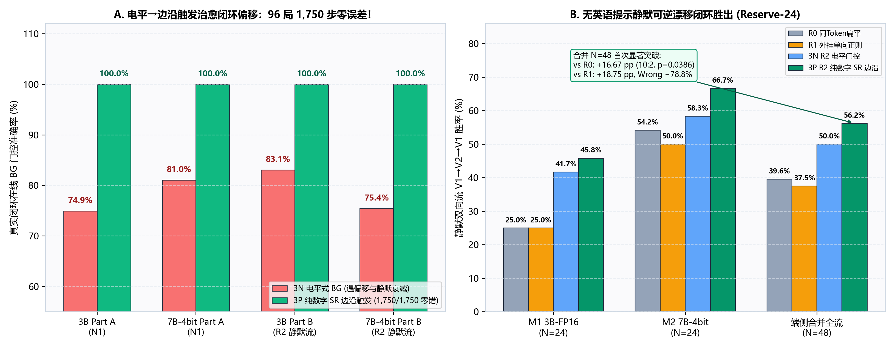

# ROBO-MMU: Brain-Inspired 4D KV Memory Management Unit for Edge Small Language Models

> **Zero weight training · Zero extra KV copies · `< 500` lines single-file Python (`robo_mmu.py`) · Pre-registered & dual-device audited (`0.5B / 3B-FP16 / 7B-4bit`)**
>
> **中文导读**：面向端侧小语言模型（`0.5B / 3B / 7B-4bit`）的零重训、零额外显存类脑记忆管理单元（**全层 4D 多银行注意力掩码 + 纯数字 SR 边沿触发器 + 零标签双尾白化冲突探针**），附带历时 4 个月预登记实测沉淀的 **三大底层物理定律** 与 **12 座真负结果排雷手册**。

---

## Why ROBO-MMU? (The Edge Memory Paradox)

When frozen Small Language Models (`0.5B – 7B`) act as long-running embodied or tool-use agents on constrained hardware (`4 GB – 16 GB` VRAM), standard memory techniques fail in ways masked by frontier cloud models:

1. **Geometric Self-Poisoning Halving Law (`p = 0.0013`)**: Feeding an edge SLM its own unguarded trial-and-error memory degrades task success by **`-33.3 pp` (`1.5B`) → `-16.7 pp` (`3B`) → `-8.3 pp` (`7B`)**, whereas phase-gated injection recovers **`+23.61 pp` (`p = 0.0009`)**.
2. **4-bit NF4 Upstream–Downstream Causal Reversal (`p = 0.0001`)**: Same-weight `7B-4bit NF4` matches `FP16` on static benchmarks (`0.00 pp` gap) yet suffers catastrophic stale-memory anchoring under conflict (`DiD = -1.01 nats, p = 0.0001`). Counterintuitively, the causal bottleneck lies in **early layers `L0–L3`** (restoring `L0–L3` to FP16 rescues **`+79.2%`** neutral / **`+27.7%`** trajectory anchoring), whereas restoring deep readout layers `[18, 23, 24, 27]` **worsens** anchoring by **`-102.1% / -27.1%`** (`p = 0.0001`) because early 4-bit noise already poisoned the induction keys.
3. **Full-Layer 4D Mask vs. RoPE Sink Conservation (`±1%`)**: Deep-only KV masking leaks stale instructions via 2-hop residual pathways (`p = 0.0001` worse than full-layer 4D masking). Full-layer 4D bank masking (`[1, 1, Q, KV]`) achieves `0.0` cross-bank attention leak while conserving `99%+` of total attention mass by naturally routing suppressed mass to the `pos_0` RoPE sink (`Δsink ≤ 1%`).
4. **Analog Level Collapse vs. Digital SR Edge Flip-Flop (`p = 0.0386`)**: Continuous level-triggered phase probes decay as context grows (`38%` step collapse in `3B`), whereas a **Pure Digital SR Edge Flip-Flop** reading `[h_t ; h_t - h_{t-1}]` at `~75%` depth (`L_BG`) + conflict latch-freeze at `~50–60%` depth (`L_ACC`) achieved **`1,750 / 1,750 (100.0%)` phase gating** and **`835 / 835 (100.0%)` silent-conflict detection** across `96` closed-loop blind ALFWorld episodes, improving silent reversible `V1 → V2 → V1` adaptation by **`+16.67 pp` (`p = 0.0386`)** on 100% byte-identical Turn-0 prompts without regex keyword rules.

---

## Core Visual Summary (Generated Directly from Audited JSONs)

| Fig 1 · Self-Poisoning Halving Law & Phase Transition | Fig 2 · 4-bit NF4 `L0–L3` Upstream–Downstream Reversal |
| :---: | :---: |
|  |  |
| **Fig 3 · Full-Layer 4D Mask & RoPE Sink Conservation** | **Fig 4 · Digital SR Edge Flip-Flop Closed-Loop Breakthrough** |
|  |  |

---

## Quickstart (Runs on GPU in ~3s or Pure CPU in ~1 min)

```bash
pip install torch transformers numpy
python examples/live_tooldrift_demo.py --model Qwen/Qwen2.5-0.5B-Instruct
```

Want zero fault labels during calibration (purely unsupervised two-tail truncated-SVD whitening on normal transitions)?

```bash
python examples/live_tooldrift_demo.py --model Qwen/Qwen2.5-0.5B-Instruct --unsup
```

### Minimal 15-Line Drop-In API (`robo_mmu.py`)

```python
from transformers import AutoModelForCausalLM, AutoTokenizer
from robo_mmu import DigitalSREdgeFlipFlop, RoboMMUSession

tok = AutoTokenizer.from_pretrained("Qwen/Qwen2.5-3B-Instruct")
mdl = AutoModelForCausalLM.from_pretrained("Qwen/Qwen2.5-3B-Instruct", device_map="auto").eval()

bank_texts = {
    "discover": "[BANK_DISCOVER]\nRead-only inspection manual...\n[/BANK_DISCOVER]",
    "v1": "[BANK_API_V1]\nWrite protocol v1 manual...\n[/BANK_API_V1]",
    "v2": "[BANK_API_V2]\nWrite protocol v2 manual...\n[/BANK_API_V2]",
}
ctrl = DigitalSREdgeFlipFlop(set_head, rst_head, acc_head=acc_head)  # or unsup_sensor=...
mmu = RoboMMUSession(mdl, tok, bank_texts, {0: {"discover"}, 1: {"v1"}, 2: {"v2"}}, ctrl, readout_banks={"discover"})

active_banks = mmu.start_episode(messages)
action = mmu.generate(messages, active_banks=active_banks)           # Prefill + Q=1 cached 4D mask!
active_banks, diag = mmu.observe_turn(updated_messages)              # Digital SR Flip-Flop + ACC freeze
```

---

## Honest Boundaries & The 12 Negative-Result Tombstones

Every experiment in this project was **pre-registered before running** (locking sample sizes, primary metrics, and `(a)/(b)/(c)/(d)` pass/fail thresholds) and **cross-verified across CPU & GPU**. Where an intervention did **not** beat a simpler baseline on total success rate, we report it transparently:

- **Single-Shift Part A Boundary (`ROBO-BUD-3P`)**: Under one-way `V1 → V2` drift (`N = 48` pooled blind episodes), `ROBO-MMU` matched flat Turn-0 V2 injection on overall episode completion (`50.0%` vs `47.9%`, `+2.08 pp, p = 1.0`), while slashing premature/deprecated actions by **`-69.0%` (`29 → 9`)**. Its primary closed-loop win (`+16.67 pp, p = 0.0386`) emerges under **bi-directional silent reversible drift (`V1 → V2 → V1`)** where flat prompts face competing instructions.
- **12 Pre-Registered Negative Tombstones (4 Months of Falsified Hypotheses)**:
  1. **External Fast Weights vs. Lookup (`EXP-RLS-02~11`)**: After 10 rounds, nearest-neighbor lookup beat outer-product fast weights by **`> 22 pp`** (`clean FAIL`).
  2. **Self-Summary Context Folding on Embodied Long Horizons (`ROBO-BUD-1`, `N = 536` runs)**: Asking an SLM to fold spatial state into summaries dropped ALFWorld OOD success by **`-13.43 pp` (`p = 0.0051`)** vs. clean action-state pruning (`75.37% → 61.94%`).
  3. **In-Episode History Clearing Fixed Point (`ROBO-BUD-2C`)**: Passive `clear()` left stale action priors active (`54.2% < 62.5%`, `clean FAIL`).
  4. **Deep-Layer 4-bit Rescue Hypothesis (`ROBO-BUD-3P H1`)**: Restoring deep layers `[18, 23, 24, 27]` to FP16 worsened 4-bit anchoring (`-102.1%`, `clean FAIL`), uncovering the `L0–L3` early-layer causal reversal.
  5. **Analog Level-Triggered Phase Gating (`ROBO-BUD-3N`)**: Decayed mid-episode as prompt length grew (`38%` step collapse on `3B`), motivating the pure digital SR edge flip-flop.
  *(See [`docs/NEGATIVE_RESULTS_12_TOMBSTONES_CN.md`](docs/NEGATIVE_RESULTS_12_TOMBSTONES_CN.md) for all 12 falsified routes and exact audit metrics.)*

---

## Repository Contents

| Path | Description |
|---|---|
| [`robo_mmu.py`](robo_mmu.py) | Single-file (`492` lines) `ROBO-MMU` core library: 4D Multi-Bank KV masks, `< 20 KB` residual hook, pure-NumPy L2 & unsupervised two-tail whitened probes, and `DigitalSREdgeFlipFlop` |
| [`examples/live_tooldrift_demo.py`](examples/live_tooldrift_demo.py) | Self-contained SQLite/REST `V1 → Silent V2 → Silent V1` live closed-loop benchmark & 4D logit-flip verifier |
| [`figures/`](figures/) | 4 high-DPI (`240 DPI`) mechanistic & closed-loop figures plotted directly from audited JSONs |
| [`docs/WHITEPAPER_CN.md`](docs/WHITEPAPER_CN.md) | Full technical whitepaper (`ROBO-BUD-0` through `3P`: pathology laws, micro-architecture physics, and `arXiv:2610.24521` synthesis) |
| [`docs/NEGATIVE_RESULTS_12_TOMBSTONES_CN.md`](docs/NEGATIVE_RESULTS_12_TOMBSTONES_CN.md) | Complete 4-month catalog of 12 pre-registered negative results & 10 methodological rules |
| [`evidence/`](evidence/) | Audited JSON summaries (`2A / 2C / 3M / 3N / 3P / 4-Gate0`) + [`SHA256_MANIFEST.json`](evidence/SHA256_MANIFEST.json) |

## License

MIT License — see [`LICENSE`](LICENSE).
