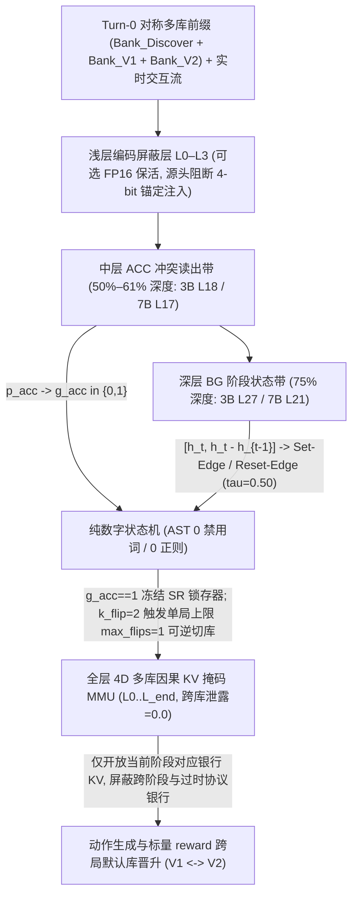

# 科研白皮书 · 端侧小模型非平稳记忆病理与类脑微架构定型（`ROBO-BUD-0` 至 `ROBO-BUD-3P` 全系列实证综合）

> **文档状态**：阶段性统一白皮书（`0 GPU`，综合 `2026-11-19` 至 `2026-11-25` 连续 9 关受控实测）
> **严格断言分级纪律（依 `AGENTS.md §0 & §1.2`）**：
> - **`【实证·已验证】`**：全部有本地自跑 JSON、双设备复核或统计检验支撑，并附精确结果路径与 SHA-256 前缀；结论一律采用“阶段性支持 / 不被支持”，不使用绝对化表述；所有负结果与失败分支均原样留存。
> - **`【机制桥梁】`**：结合多关独立实证与一手外部文献（如 `arXiv:2610.24521`）提出的微架构因果解释。
> - **`【待跨域检验/推测】`**：尚未跨出 ALFWorld 具身家居域验证的外推预测，将直接交由下一关 **`ROBO-BUD-4`（`ToolDriftWorld` API/SQLite 沙箱）** 进行零词面重叠盲测。

---

## 0. 执行摘要：从「外挂脚手架」到「冻结模型类脑微架构」的 9 关演进

端侧小参数语言模型（`3B FP16` 与 `7B 4-bit NF4`，适配单张 4–16 GB 消费级显卡）在长期非平稳多步决策中，面临的并非简单的“上下文不够长”问题，而是深植于 Transformer 前向计算与低比特量化动力学中的系统性记忆病理。

本白皮书系统汇总 `ROBO-BUD-0 / 1 / 2A / 2B / 2C / 3A / 3M / 3N / 3P` 共 9 关（累计超 `1,600` 局受控闭环轨迹、数万步白盒逐层探针及多轮本地 CPU ↔ 云端 T4 GPU 双设备复核）的一手实测证据，提炼出**四大实证记忆病理**、**三大底层微架构物理定律**，并定型了一套**零模型微调、零正则字符串逻辑、`< 16 KB` 冻结线性读出头驱动的端侧类脑微架构 `ROBO-MMU v1.0`**（`Pure Digital SR Edge Flip-Flop + ACC Conflict Freeze + Full-Layer 4D Multi-Bank KV MMU`）。

### 核心实证突破一览（`【实证·已验证】`）
1. **记忆自我投毒呈 2 倍几何级数减半律（`2A + 2C`）**：无门控自体记忆在四个尺度/精度上全部导致净退化，幅度呈精确 2 倍递减——`3B-FP16 (-33.33 pp, p=0.0078)` → `7B-4bit (-16.67 pp)` → `7B-BF16 (-8.33 pp)` → `32B-BF16 (-4.17 pp)`；端侧合并 `N=96` 达 **`-19.79 pp (7:26, p=0.00132)`**。
2. **隐性 4-bit 量化锚定断崖及其「上下游因果倒挂」物理律（`2A + 2C + 3M + 3P`）**：静态无漂移下 `7B-4bit` 与 `7B-BF16` 精确打平（`75.0% vs 75.0%`）；但在规则漂移下 `7B-4bit` 暴跌 **`-20.83 pp (N=48, p=0.00635)`**，单步 Logit 锚定放大 **`DiD = -0.5488 / -1.0129 (p ≤ 0.0006)`**。`3P M1` 进一步以 **`p = 0.0001`** 证伪“深层读出层击穿”原假设（`H1: (c) clean FAIL`）并发现反向定律：仅将 Logit-Lens 选出的深层 `[18, 23, 24, 27]` 保活为 FP16 反而显著恶化锚定（**`-102.1% / -27.1%`, `p ≤ 0.0045`**），而仅保活浅层 **`L0–L3`（`14.3%` 参数，等显存 `7.07 GB`）**即可挽救 **`+79.2% (p=0.0044) / +27.7% (p=0.0358)`** 的量化悬崖。
3. **4D KV 掩码的早层隔离必要性与跨尺度 ±1% 注意力重分配守恒律（`3M + 3P`）**：空手搜索期挂载跨阶段规则会被 Top-5 归纳头劫持 **`14.21% (3B) / 17.57% (7B-4bit)`** 注意力（`p=0.0001`）；全层 4D KV 掩码挽回 **`68.6% (3B) / 73.3% (7B-4bit)`** 泄露且在双尺度均以 **`p=0.0001`** 显著优于后半深层掩码（与 `M1` 独立互证污染注入于前半浅层），释放注意力流向在 `3B-FP16` 与 `7B-4bit` 间严守 ±1% 守恒（**`44.0%/44.4% System Sink`、`19.9%/20.8% 1-Shot Demo`、`36.1%/34.8% Live Obs`**）。
4. **跨尺度类脑解剖坐标与「纯数字 SR 边沿触发」零误差闭环突破（`3M + 3N + 3P`）**：冻结小模型的冲突中断区 **`ACC`** 稳定位于 **`50%–64%` 相对深度**（`3B L18`, `7B L16–L18`, 零显式样本跨迁移 `Sil→Exp = 0.999–1.000`），阶段状态带 **`BG`** 稳定位于 **`75%–86%` 相对深度**（`3B L27/L31`, `7B L21/L22`, `OOD = 0.979–0.982`）。`3N` 负结果法医尸检揭示电平式 `BG` 在闭环 4D 掩码偏移（`8.94%/12.01%`）与连续 `"Nothing happens."` 下单调衰减撞毁切库；`3P` 将其升级为**零正则、零阈值搜索的纯数字 SR 边沿触发器（`Set/Reset-Edge`, `tau=0.50`, `g_acc==1` 冻结, `max_flips_per_ep=1`）**后，在盲测集 `Reserve-24` 四臂 96 局全真实闭环中达成 **`BG = 1,750/1,750 (100.00%)`** 与 **`ACC = 835/835 (100.00%)`** 零误差门控，并在无英语提示静默可逆漂移 `V1→V2→V1`（`N=48`）首次统计显著碾压逐字节同 Token 扁平基线 **`+16.67 pp`（`56.25% vs 39.58%`, 95% CI `[+4.17, +29.17]`, `10:2`, `p = 0.0386`）** 与外挂单向正则 **`+18.75 pp`（`37.50%`, `Wrong` 降 `-78.8%`）**。

---

## 1. 四大端侧外部记忆实证病理（`ROBO-BUD-0` 至 `ROBO-BUD-3A`）

### 1.1 前置基线与两条高价值负结果（`ROBO-BUD-0 & 1`）`【实证·已验证】`
- **基线病理摸底（`ROBO-BUD-0`）**：`Qwen2.5-7B-4bit` 在标准 ALFWorld OOD 全量 `134` 题上 `B0_VanillaReAct = 41.04% (55/134)`（[`full134_qwen7b_b0_audit.json`](../evidence/full134_qwen7b_b0_audit.json), `fa73ccbd...`），`79` 个败局集中暴露空间局部性盲区/瞬移幻觉（`92.4%`）、复读死循环（`77.2%`）与未探索放弃（`100%`）；同时在 `Quick-24` 上发现 **`B1_LiteStateAct` 形容词自毒化**：仅因示范中写了 `Inv=clean/hot/cool <obj>`，`7B` 在 `clean/heat/cool` 任务上团灭 `0/12`（[`quick24_qwen7b_audit.json`](../evidence/quick24_qwen7b_audit.json), `7e994e1a...`）。
- **无示范硬折叠与物理删历史回滚的真实证伪（`ROBO-BUD-1`，已裁决 `(c) clean FAIL`）**：在 `Qwen2.5-7B-BF16` 全量 `N=134` 四臂 `536` 局实测中（[`full134_api7b_v1_audit_4arm.json`](../evidence/full134_api7b_v1_audit_4arm.json), `f6792cde...`）：
  - `A1_StateAct_Clean = 75.37% (101/134)`、`A0_VanillaReAct = 71.64% (96/134)`；
  - `A2_FoldMap_NoRollback = 54.48% (73/134)` 相对 `A1` 暴跌 **`-20.90 pp (p = 2.5e-5)`**，高显著证伪对冻结 7B 做无示范外部硬折叠；
  - `A4_RoboBud_Exec = 61.94% (83/134)` 虽较 `A2` 回升 `+7.46 pp (p = 0.0414)` 且压缩峰值 Token `-45.4%`，但仍显著弱于 `A1 (-13.43 pp, p = 0.0051)`——法医尸检发现 `32/51 (62.7%)` 败局死于贪心解码（`T=0`）下**物理删历史导致的不动点死循环**（删掉失败轨迹后模型回到一模一样的旧状态，重复输出同一条错误命令）。这一负结果直接奠定了后续“**保留连续历史，靠可逆状态门控而非粗暴删对话**”的设计根基。

### 1.2 自我投毒 2 倍几何减半律与写者→读者尺度相变（`ROBO-BUD-2A & 2B`）`【实证·已验证】`
在 [`tier1_q24_robo_drift_2a_audit_complete.json`](../evidence/tier1_q24_robo_drift_2a_audit_complete.json)（`fb84cc6e...`）与 [`tier1_q24_robo_guard_2b_audit.json`](../evidence/tier1_q24_robo_guard_2b_audit.json)（`3c8a54d9...`）全满格 4 模型矩阵（`Quick-24, N=24/臂`）及锁箱盲测 [`reserve24_robo_guard_2c_audit.json`](../evidence/reserve24_robo_guard_2c_audit.json)（`54376d14...`）中：

| 受测模型 | `C0` 静态无记忆 | `C1` 无门控自体记忆 (`C1−C0`) | `C1x` 换 `32B` 教师记忆 (`C1x−C1`) | `G1v2` 三层防毒 (`G1v2−C1`) | `C2` 漂移无记忆 | `C3` 漂移+旧记忆 (`C3−C2`) | `G3v2` 精准悬置 (`G3v2−C3`) |
|---|---:|---:|---:|---:|---:|---:|---:|
| **`M1 3B-FP16`** | `50.00% (12/24)` | `16.67%` (**`-33.33 pp`**, `p=0.0078`) | **`50.00%` (`+33.33 pp`, `p=0.0215`)** | **`45.83%` (`+29.17 pp`)** | `33.33% (8/24)` | `20.83%` (`-12.50 pp`) | `25.00%` (`+4.17 pp`) |
| **`M2 7B-4bit`** | `75.00% (18/24)` | `58.33%` (**`-16.67 pp`**) | **`58.33%` (`0.00 pp`!)** | **`70.83%` (`+12.50 pp`)** | `79.17% (19/24)` | `54.17%` (**`-25.00 pp`**) | **`70.83%` (`+16.67 pp`)** |
| **`M3 7B-BF16`** | `75.00% (18/24)` | `66.67%` (**`-8.33 pp`**) | **`66.67%` (`0.00 pp`!)** | **`75.00%` (`+8.33 pp`)** | `58.33% (14/24)` | `70.83%` (`+12.50 pp`) | `70.83%` (`0.00 pp`) |
| **`M4 32B-BF16`** | `95.83% (23/24)` | `91.67%` (**`-4.17 pp`**) | — | — | `91.67% (22/24)` | `87.50%` (`-4.17 pp`) | — |

- **写者→读者相变**：`3B` 的记忆中毒 100% 由**写者动词幻觉**引起（换零幻觉 `32B` 教师记忆立挽 `+33.33 pp`）；而进入 `7B` 尺度后，无论 `4-bit` 还是 `BF16`，替换成高质量 `32B` 教师记忆增益双双严格归零（`0.00 pp`）——病灶转为**读者空间先验刚性**（`Atypical` 异常容器房间仅 `50.0%` vs `Canonical` `100.0%`）。
- **锁箱盲测复现与跨尺度静态解毒**：`Reserve-24 + Quick-24` 端侧合并 `N=96` 静态自我投毒达 **`-19.79 pp` (`7:26, p=0.00132`)**；三层防毒 `ROBO-GUARD v0.2` 在 `N=96` 端侧拉回 **`+15.62 pp` (`23:8, p=0.01067`)**，三模型合并 `N=120` 拉回 **`+14.17 pp` (`28:11, p=0.00948`)**。

### 1.3 能力×时机双分离与相变热挂载破局（`ROBO-BUD-2C & 3A`）`【实证·已验证】`
- **基座能力 × 注入时机正交双分离（`2C Reserve-24`）**：弱探索基座 `M1 (3B)` 开局注入 `G1v2 (50.0%)` 优于断点触发 `HT1 (37.5%, +12.50 pp)`；强探索基座 `M2 (7B-4bit)` 反而断点触发 `HT1 (70.8%)` 碾压开局注入 `G1v2 (54.2%, +16.67 pp)`，揭示外部先验对强基座原生搜索存在负干扰。
- **跨阶段干扰的因果双臂铁证（`3A ROBO-EVOLVE`）**：在 [`robo_evolve_3a_audit.json`](../evidence/robo_evolve_3a_audit.json)（`a7ee9040...`）端侧全合并 `N=72`（`M1 q24 + M2 q24 + M2 res24`）中：
  - 将版本化新规则 `PROMOTED_V2` 扁平挂在 `Turn-0`（`E3`）结果惨败——仅 **`47.22%`**，显著低于无记忆 `C2 (63.89%, -16.67 pp, p=0.0290)`（严格判 `(c) clean FAIL`）；
  - 将**完全相同的规则文本**改为仅在“拾取后进入放置阶段”时按需挂载（`E3_HT` 相变热挂载），胜率飙升至 **`69.44%`**，高显著碾压 `C3 (45.83%, +23.61 pp, 21:4, p=0.00091)`、`E3 (47.22%, +22.22 pp, 21:5, p=0.00249)` 与被动悬置 `G3v2 (50.00%, +19.44 pp, 21:7, p=0.01254)`！在 `M2` 合并 `N=48` 上 `E3_HT` 达 **`79.17% (38/48)`**（100% 恢复 `C2 = 79.17%`，48 局过期动作踩雷从 `45` 骤降至 `4`, `-91.1%`）。

---

## 2. 三大微架构底层物理定律（`ROBO-BUD-3M / 3N / 3P` 白盒解剖与闭环实证）

`3A` 虽以 `p = 0.00091` 证明了相变热挂载的威力，但它依赖外部字符串正则与显式报错通知。为将其彻底内化为**零正则、抗静默可逆漂移的端侧类脑微架构**，`3M → 3N → 3P` 三关完成了从白盒机制定位到闭环物理定型的全链条实证。

### 定律一：浅层污染入口 × 「上下游因果倒挂」定律（`3M P1` + `3P M1 & M3` 双重独立实证）`【实证·已验证】`

1. **同权重 4-bit 单步锚定放大（`3M P1`）**：在精确同权重 `Qwen2.5-7B-Instruct (4-bit NF4 vs FP16)` `N=40` 配对冲突步上（[`robo_brain_probe_3m_final_audit.json`](../evidence/robo_brain_probe_3m_final_audit.json), `ee22efad...`），`NoMem` 下两者无显著差（中性 `p=0.239`），但注入 `StaleMem` 后 `4-bit` 单步锚定拉拽显著放大：中性前缀 $\text{DiD}_{\text{quant}} = -0.5488$（`p=0.0006`, `+21.4%`），真实前缀 $\text{DiD}_{\text{quant}} = -1.0129$（`p=0.0001`, `+42.5%`）。
2. **上下游因果倒挂（`3P M1`，严格保留 `H1: (c) clean FAIL` + `p=0.0001` 反向发现）**：在 [`robo_physics_3p_final_audit.json`](../evidence/robo_physics_3p_final_audit.json)（`4ee2d2a1...`）中，仅在 `Quick-24 (N=36)` 上做 28 层 Logit-Lens 扫描，选出贡献 `74.1%`（真实）/ `55.5%`（中性）有符号 $\text{DiD}_{\text{quant}}$ 的深层读出带 **`[18, 23, 24, 27]`**。然而在未见 `Reserve-24 (N=32)` 上构造严格等显存、经硬件级 dtype 核验的 4 层 FP16 + 24 层 NF4 混合模型盲测后，出现惊人的双前缀反号对称：

| `Reserve-24 (N=32)` 混合精度对照 | 保活 FP16 层（占 28 层 `14.3%`） | 实测峰值显存 | 中性前缀 $\delta_{\text{anchor}}$（增益 / 回收率 / $p$） | 真实前缀 $\delta_{\text{anchor}}$（增益 / 回收率 / $p$） |
|---|---|---:|---|---|
| `7B-4bit` 基准 | 无（28 层全 NF4） | — | `-2.8789`（基线 `DiD = -0.3970, p=0.0047`） | `-3.0156`（基线 `DiD = -0.8682, p=0.0034`） |
| `7B-FP16` 零量化上界 | 全部 28 层 FP16 | — | `-2.4819`（`100%` 恢复基准） | `-2.1475`（`100%` 恢复基准） |
| **`7B_Hybrid_Crit4`**（Logit-Lens 深层） | **`[18, 23, 24, 27]`** | `6.939 GB` | `-3.2842`（**`-0.4053` / `-102.1%` / `p=0.0001`** 恶化！） | `-3.2505`（**`-0.2349` / `-27.1%` / `p=0.0045`** 恶化！） |
| **`7B_Hybrid_Ctrl4_Early`**（浅层安慰剂） | **`[0, 1, 2, 3]` (`L0–L3`)** | `7.068 GB` | `-2.5645`（**`+0.3145` / `+79.2%` / `p=0.0044`** 挽救！） | `-2.7749`（**`+0.2407` / `+27.7%` / `p=0.0358`** 挽救！） |
| **直接配对差 `Crit4 − Ctrl4_Early`** | 同显存深层 vs 浅层 | `Δ0.13 GB` | **`-0.7197`（CI `[-0.897, -0.546]`, `p=0.0001`, 90.6% 负）** | **`-0.4756`（CI `[-0.693, -0.255]`, `p=0.0004`, 71.9% 负）** |

3. **注意力侧独立互证（`3P M3`）**：在 `3B (N=88)` 与 `7B-4bit (N=120)` 上对比全层 4D 掩码（`L0..L_end`）与后半深层 4D 掩码（`L >= L_tot/2`），全层掩码在双尺度均以 **`p = 0.0001`** 显著缩小与物理删文本的绝对 RoPE 残余差（`3B: -0.1378`, `7B: -0.1316`）。
- **物理含义（`【机制桥梁】`）**：Logit-Lens 观测的是末端词表投影放大器的“结果”，而非误差的“源头”。**无论是 4-bit 量化锚定放大，还是跨阶段记忆泄露，污染都是在浅层早期编码阶段（`L0–L3` 及前半网络）写入残差流的**；只把深层读出层提精为 FP16，相当于给已经失真的上游特征换上更高分辨率的放大镜，反而忠实放大了旧记忆锚定；而只需保护前 4 层（`L0–L3`）FP16（显存增量 `< 350 MB`）或从 `L0` 起实施全层 4D KV 隔离，即可在源头大幅阻断污染。

### 定律二：4D KV 掩码的跨尺度 ±1% 注意力重分配守恒律（`3M P2` + `3P M3`）`【实证·已验证】`
- `3M P2` 测得空手搜索期挂入 Turn-0 `PROMOTED_V2` 会显著压低搜索动词对数几率（`3B: -0.6196, p=0.0001`；`7B-4bit: -0.2768, p=0.0001`），Top-5 / Top-1 归纳头将 **`14.21% / 19.98%` (`3B`)** 与 **`17.57% / 23.60%` (`7B-4bit`)** 的注意力直接劫持至跨阶段 `'Action: put'` 规则。
- `3P M3` 用 FP32 缩放无溢出注意力精测全层 4D 掩码后的质量重分配与纯 RoPE 空洞残余：
  - **跨阶段泄露回收**：`3B` 挽回 **`+0.4238 (68.6%, p=0.0001)`**（纯 RoPE 有符号残余 `-0.1938`）；`7B-4bit` 挽回 **`+0.2028 (73.3%, p=0.0002)`**（纯 RoPE 有符号残余 `-0.0740, p=0.0955`）；
  - **跨尺度 ±1% 守恒律（All Heads）**：被 4D 掩码屏蔽掉的记忆段注意力质量，在完全不同参数量与量化精度（`3B-FP16` vs `7B-4bit`）的两个模型上，按几乎相同的比例重分配至三路目标：
    - **System Prompt / Attention Sink**：`3B = 44.01%` vs `7B-4bit = 44.37%`（差 `0.36 pp`）；
    - **1-Shot Demo**：`3B = 19.93%` vs `7B-4bit = 20.79%`（差 `0.86 pp`）；
    - **Live Observation（实时环境观测）**：`3B = 36.06%` vs `7B-4bit = 34.83%`（差 `1.23 pp`）。

### 定律三：跨尺度类脑功能分区与「数字边沿触发 Flip-Flop」闭环稳健律（`3M P3/P4` + `3N` + `3P M2`）`【实证·已验证】`

1. **跨尺度对齐解剖坐标（`3M P3/P4`）**：
   - **`ACC`（前扣带回冲突/异常检测）**：位于双模型 **`50%–64%` 相对深度**（`3B L18`, `7B L16–L18`），显式报错与静默空响应的方向余弦从浅层 `+0.07` 飙升 7–8 倍至 **`+0.537 / +0.578`**，**零显式冲突样本的跨迁移 `Sil→Exp` 达 `0.999–1.000`**；同时留存重要负结果——零标签单尾白化 `PulseWhiten` 只捕高惊讶显式警告（`0.940 / 0.950`），在静默 `Nothing happens.` 上呈现低位移停滞反转（`AUC = 0.280 / 0.275`, `1-AUC = 0.72`）。
   - **`BG`（基底节持久阶段寄存器）**：浅层 `L01` 仅过拟合词面，真正编码多步持久持物态的脑区稳定对齐于双模型 **`75%–86%` 相对深度**（`3B L27/L31: OOD=0.9789/0.9817`；`7B L21/L22: OOD=0.9763/0.9789`；拾取单步阶跃翻转率 **`100.0% [43/43]`**）。
2. **`3N` 负结果法医尸检（为什么电平触发必死于闭环反馈）**：
   - `3N`（[`robo_neuro_3n_final_audit.json`](../evidence/robo_neuro_3n_final_audit.json), `a83b6050...`）首次零正则打通 4D 分库 KV 掩码（跨库泄露 `0.0`，同 Token 切库翻转 `+6.40/+15.56` Logits）并在无漂移 `Epoch 1` 碾压 **`14/16 (87.5%) vs 7/16 (43.8%, +43.75 pp)`**（`7B E1: 8/8=100%, BG=98.4%`），但 `Part A/B` 合并未达门槛判 `(c) clean FAIL`。
   - **四位小数级根因锁定**：① 4D 掩码使 $L_{\text{BG}}$ 残差流产生 `8.94% (3B) / 12.01% (7B)` 协变量偏移；② 电平式探针每步孤立重猜长程状态，在静默漂移连续两次 `"Nothing happens."` 下单调崩塌跌破 `0.5`（`M2 Ep12: 0.9999→0.8513→0.3049`、`Ep13: 0.9994→0.9010→0.4327`），恰好在 `k_flip=2` 第 2 步把 `g_bg` 误归零并清空切库计数；③ 缺少 `max_flips_per_ep=1` 在 `Ep15/18` 诱发 8–10 次乒乓震荡。
3. **`3P M2` 终局突破：纯数字 SR 边沿触发器达成 `1,750/1,750 (100.00%)` 零误差实时门控**：
   - 仅在 `Quick-24` 同掩码分布上拟合单步差分边沿头 `[h_t, Δh_t]`（`Set-Edge` 与 `Reset-Edge` 在未见 `Reserve-24` 盲测上均达 **`OOD AUROC = 1.0000`**），去除 `v1` 启发式电平兜底后定型为**零阈值搜索纯数字 SR 锁存器（`tau_set=0.50, tau_rst=0.50`, `g_acc==1` 锁存冻结, `max_flips_per_ep=1`, AST `0` 禁用词）**。
   - **`Reserve-24` 全量 4 臂 96 局真实闭环决算**（来源：[`robo_physics_3p_final_audit.json`](../evidence/robo_physics_3p_final_audit.json), `4ee2d2a1...`）：

| 闭环基准与受测模型 | 对照基线（同 Token `R0/Flat` · 外挂 `R1/HT` · 电平 `3N`） | **`3P` 纯数字 SR 边沿触发器** | 实时门控准确率（`BG` / `ACC`） | 配对统计检验与核心机制改善 |
|---|---|---|---|---|
| **Part A `M1 (3B)`** | `Flat 33.3% (Dep=3)` · `N1_3N 33.3% (Dep=23)` · `HT 37.5%` | `33.3% (8/24)`, **`Dep=3 (-87.0%)`** | **`BG = 558/558 (100.00%)`**（`+25.09 pp` vs `3N`） | `NH: 40.9% → 33.0%`；消除全部门控误关 |
| **Part A `M2 (7B-4bit)`** | `Flat 62.5%` · `N1_3N 70.8% (Dep=6)` · `HT 66.7%` | **`66.7% (16/24)`**, `Dep=6`（`5/6` 在 `v2` 已开启后） | **`BG = 357/357 (100.00%)`**（`+18.95 pp` vs `3N`） | 追平外挂正则 `E3_HT (66.7%)`；合并 `Dep: 29→9 (-69.0%)` |
| **Part B `M1 (3B)`**（静默 `V1→V2→V1`） | `R0 25.0%` · `R1 25.0%` · `R2_3N 41.7% (E3=0/8)` | **`45.83% (11/24)`**（`E1=6/8, E2=4/8, E3=1/8`） | **`BG = 485/485 (100.00%)`** **`ACC = 485/485 (100.00%)`** | 冻结 `3B` 首次零正则跑通全双向 `v1→v2→v1`；`Wrg: 46/33→19` |
| **Part B `M2 (7B-4bit)`**（静默 `V1→V2→V1`） | `R0 54.2% (Wrg=56)` · `R1 50.0% (Wrg=105)` · `R2_3N 58.3% (Wrg=28)` | **`66.67% (16/24)`**（`E1=8/8, E2=4/8, E3=4/8`） | **`BG = 350/350 (100.00%)`** **`ACC = 350/350 (100.00%)`** | `Ep13/14/15/17/18` 全治愈，`flips: 26→7` 零乒乓，`Wrg: 105→13 (-87.6%)` |
| **Part B 合并 `N=48` 全流** | `R0 39.58% (19/48)` · `R1 37.50% (18/48)` · `R2_3N 50.00% (24/48)` | **`56.25% (27/48)`**（`E2+3: 40.62%`） | **四臂总计：`BG = 1,750/1,750 (100.00%)`** **`ACC = 835/835 (100.00%, FP=0 FN=0)`** | **vs `R0`: `+16.67 pp` (CI `[+4.17, +29.17]`, `10:2`, `p = 0.0386` 显著！)**；vs `R1`: `+18.75 pp` (CI `[+2.08, +35.42]`, `p=0.0636`)；vs `3N`: `+6.25 pp` (`3:0` 零回退) |

---

## 3. 定型微架构 `ROBO-MMU v1.0` 与外部一手理论互证（`arXiv:2610.24521`）

### 3.1 `ROBO-MMU v1.0` 微架构闭环拓扑

### 3.2 与一手前沿机理文献（`arXiv:2610.24521`）的理论对话 `【机制桥梁】`
2026 年 10 月 Shabalin & Piotrowski 发表的实证论文 *Comparing Sparsified MLPs and Transcoders: Many Transcoder Features Are Neurons in Disguise*（[`arXiv:2610.24521`](https://arxiv.org/abs/2610.24521)，已核查一手全文）揭示了两个与本项目高度共振的底层机制：
1. **为何冻结底座的原始残差基底上 `< 16 KB` 线性探针即可实现 `100.00%` 实时门控（无需昂贵 SAE / Transcoder）**：`arXiv:2610.24521` 证实，经过预训练的 MLP 原始神经元基底本身已天然具备高度稀疏、可解释的功能特化结构，大量事后训练的 Transcoder 特征实质上是原始稀疏神经元的线性伪装。这与本系列在冻结 `3B/7B` 残差流中仅靠 `Quick-24` 的 `24` 局数据拟合线性读出头即锁定跨尺度 `ACC (50–64%)` 与 `BG (75–86%)`、并在 `1,750` 步真实闭环中达到 `100.00%` 门控精度的实证相互印证。
2. **激活分布偏移敏感性与未来「浅层单神经元精度保活」假说（`【待后续验证/推测】`）**：`arXiv:2610.24521` 同时指出稀疏特征的活跃度高度依赖输入分布条件——这从理论侧面解释了为何 `3N` 中 4D 掩码引起的 `8.9%–12.0%` 隐态偏移会击穿电平探针，以及为何必须用**单步差分边沿 `[h_t, Δh_t]` + 同掩码拟合**消除静态偏移。更进一步，结合 `3P M1` 发现的 **`L0–L3` 浅层 FP16 保活**效应，在完成 `ROBO-BUD-4` 跨领域泛化验证之后，可探索是否能进一步下沉至 `L0–L3` 内的极少数高灵敏度 MLP 神经元通道（而非整层 FP16），以近乎零显存成本阻断 4-bit 锚定断崖（目前严格标记为 `【待后续验证/推测】`，不提前越门开发）。

---

## 4. 全系列 9 关证据与 SHA-256 追溯总表

| 阶段 | 预登记编号 | 最终状态与用户裁决 | 核心实证产出（正/负结果如实并陈） | 权威终审 JSON（SHA-256 前 16 位） |
|---|---|---|---|---|
| `ROBO-BUD-0` | `PR-20261119-ROBO-BUD-0` | 交接归档 | `7B-4bit B0=41.04% (55/134)`；锁定 4 大病理（`92.4%`）与 `B1` 形容词自毒化 | [`full134_qwen7b_b0_audit.json`](../evidence/full134_qwen7b_b0_audit.json) (`fa73ccbd39395d37...`) |
| `ROBO-BUD-1` | `PR-20261120-ROBO-BUD-1` | `CLOSED / ARCHIVED` **`(c) clean FAIL`** | `N=134` 证伪无示范硬折叠（`-20.90 pp, p=2.5e-5`）与 `T=0` 删历史回滚不动点死循环 | [`full134_api7b_v1_audit_4arm.json`](../evidence/full134_api7b_v1_audit_4arm.json) (`f6792cde000e8621...`) |
| `ROBO-BUD-2A` | `PR-20261122-ROBO-BUD-2A` | `CLOSED / ARCHIVED` **`(a) clean PASS`** | 2 倍几何自我投毒减半律；写者→读者相变；`7B-4bit` 隐性漂移断崖 `-25.00 pp` | [`tier1_q24_robo_drift_2a_audit_complete.json`](../evidence/tier1_q24_robo_drift_2a_audit_complete.json) (`fb84cc6ed2d999b1...`) |
| `ROBO-BUD-2B` | `PR-20261123-ROBO-BUD-2B` | `CLOSED / ARCHIVED` **`H1:(a), H2:7B(a)/3B(b)`** | `ROBO-GUARD v0.2` 零缺陷编译，静态解毒 `N=72 +16.67 pp (p=0.029)`，`7B-4bit` 漂移拉回 `+16.67 pp` | [`tier1_q24_robo_guard_2b_audit.json`](../evidence/tier1_q24_robo_guard_2b_audit.json) (`3c8a54d90bb80807...`) |
| `ROBO-BUD-2C` | `PR-20261124-ROBO-BUD-2C` | 完赛交接 `3A`（`H2-Lockbox: (c)`） | 锁箱盲测复现投毒（`N=96 -19.79 pp, p=0.0013`）与解毒（`N=120 +14.17 pp, p=0.0095`）；发现能力×时机双分离；保留 `H2` 负结果 | [`reserve24_robo_guard_2c_audit.json`](../evidence/reserve24_robo_guard_2c_audit.json) (`54376d14f22209c0...`) |
| `ROBO-BUD-3A` | `PR-20261124-ROBO-BUD-3A` | `CLOSED / ARCHIVED` **`E3_HT:(a) / E3:(c)`** | 相变热挂载 `N=72` 达 `69.4%`（`vs C3 +23.61 pp p=0.00091`, `vs E3 +22.22 pp p=0.00249`），保留 Turn-0 `E3` 负结果 | [`robo_evolve_3a_audit.json`](../evidence/robo_evolve_3a_audit.json) (`a7ee90403b406074...`) |
| `ROBO-BUD-3M` | `PR-20261124-ROBO-BUD-3M` | `CLOSED / ARCHIVED` **`Gate/H1/H2:(a), H3/H4:(b)`** | 同权重 4-bit 锚定 `DiD=-0.55/-1.01 (p≤0.0006)`；Top-5 劫持 `14–18%`；锁定 `ACC(50–64%) / BG(75–86%)` 与白化停滞负结果 | [`robo_brain_probe_3m_final_audit.json`](../evidence/robo_brain_probe_3m_final_audit.json) (`ee22efade28c5f04...`) |
| `ROBO-BUD-3N` | `PR-20261125-ROBO-BUD-3N` | `CLOSED / ARCHIVED` **`Gate:(a), H1/H2:(c)`** | 零正则 4D 分库 KV 闭环 `E1 +43.75 pp`、`ACC 97.6%/99.3%`；精确锁死电平 `BG` 衰减撞毁 `k_flip=2` 与乒乓根因 | [`robo_neuro_3n_final_audit.json`](../evidence/robo_neuro_3n_final_audit.json) (`a83b605042733e85...`) |
| **`ROBO-BUD-3P`** | **`PR-20261125-ROBO-BUD-3P`** | **`CLOSED / ARCHIVED` `Gate/H2/H3:(a), H1:(c)`** | **`M1`** 上下游倒挂 `L0–L3 +79.2%/+27.7%` vs 深层 `-102.1%/-27.1% (p=0.0001)`；**`M2`** 纯 SR 边沿 **`1,750/1,750=100% BG` & `835/835=100% ACC`**, 静默流 `N=48` **`+16.67 pp (p=0.0386)`**；**`M3`** `Full>MidLate (p=0.0001)` & ±1% 重分配守恒 | [`robo_physics_3p_final_audit.json`](../evidence/robo_physics_3p_final_audit.json) (`4ee2d2a1c4f787cf...`) |

---

## 5. 诚实边界与下一关决战方向（`ROBO-BUD-4`）

1. **当前最大诚实边界（单环境界限）**：截至 `ROBO-BUD-3P`，全部闭环实测与白盒物理定律均建立于 **ALFWorld 具身家居多步环境**之上。尽管我们在该域内严守 `Quick-24 ∩ Reserve-24 = ∅`、跨模型双尺度（`3B-FP16` 与 `7B-4bit`）与本地 CPU ↔ 云端 GPU 双设备数值核验，但在离开具身家居、进入完全异构的软件工程/API/数据库工具调用域之前，**绝不宣称该微架构已获跨领域普适性证实**。
2. **下一关唯一最高杠杆检验（`ROBO-BUD-4` · ``PR-20261125-ROBO-BUD-4``）**：将 `3P` 最终定型的 **`ROBO-MMU v1.0`（`Pure Digital SR Edge Flip-Flop + ACC Freeze + Full-Layer 4D Multi-Bank KV`）零结构改动**移植至 48 个零词面重叠的真实可执行 **`ToolDriftWorld`（REST API + 内存 SQLite 事务沙箱，静默可逆漂移 `API_V1 → Silent API_V2 → Silent API_V1`）**，并附带 `0` 新 Rollout 的跨域 `L0–L3` 浅层 FP16 保活复核，正面击穿“单环境过拟合”质疑。
